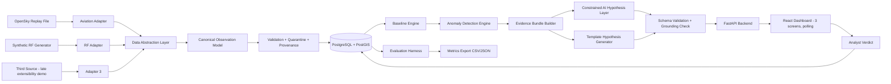
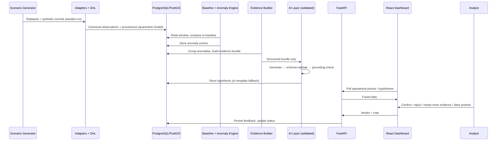
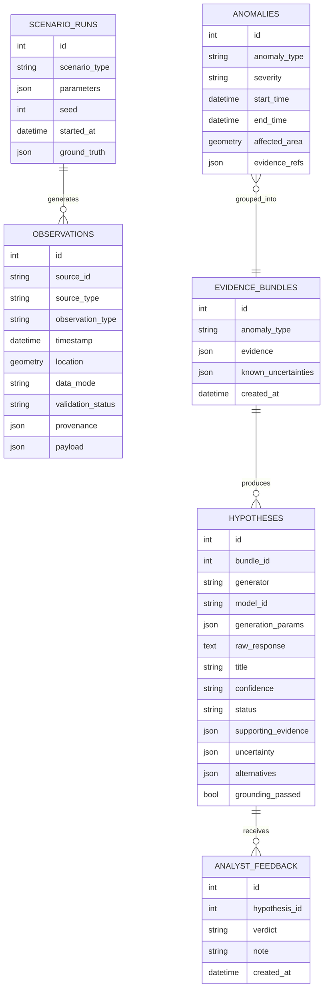

# Project Scope: EM Fusion (v2)

This is the build-facing scope. The academic framing, research questions, evaluation design, and thesis structure live in `EM-Fusion-Project-Scope-v2.docx`. The step-by-step build order lives in `implementation.md`. If the three documents disagree, the docx wins on academic scope and this document wins on technical detail.

## 1. Project Name

**EM Fusion: A Human-in-the-Loop AI Prototype for Explainable Electromagnetic Situational Awareness**

## 2. One-line Summary

EM Fusion is a prototype decision-support platform that fuses replayed open aviation telemetry and synthetic RF sensor observations through a Data Abstraction Layer, detects deviations from baseline behaviour, and converts structured evidence bundles into explainable, machine-validated hypotheses for human analyst review on a geospatial dashboard.

## 3. Core Project Pitch

In congested and contested environments, operators may need to understand whether unusual behaviour in aircraft, positioning systems, or data feeds could indicate interference, degradation, sensor faults, or data-source failure.

This prototype does **not** attempt to build a real military electromagnetic warfare system. It demonstrates how a modern data platform could ingest multiple evidence streams, normalise them into a canonical model, fuse them in time and space, detect anomalies deterministically, and hand a *constrained* AI layer structured evidence from which to generate explainable hypotheses for human review.

The core pattern, and the thing the whole build serves:

```
Data → Validation → Baseline comparison → Anomaly detection
     → Evidence bundle → Constrained AI hypothesis → Automated validation
     → Human review
```

The AI never sees raw unfiltered data and never invents evidence. Its output is schema-validated and grounding-checked before an analyst sees it.

---

## 4. MVP Objective

> Can we build a full-stack prototype that fuses replayed aviation telemetry with synthetic RF observations through a canonical Data Abstraction Layer, detects deviations deterministically, and generates evidence-grounded, machine-validated hypotheses that a human analyst can inspect, challenge, and validate?

The MVP is **decision support**, not autonomous decision-making. Every hypothesis ends at an analyst verdict.

---

## 5. MVP Scope

### Data Sources (v1)

Two sources at launch, a third added late as a measured extensibility demonstration:

1. **Replayed open aviation telemetry** — OpenSky Network historical state vectors, downloaded once, archived, and replayed deterministically from file. No live API dependency: replays are reproducible, offline, and immune to rate limits. Record licence/attribution requirements.
2. **Synthetic RF sensor observations** — generated under scenario control (frequency, band, power, SNR, bandwidth, baseline delta, severity).
3. **Third adapter (late-project)** — a simple additional source (e.g. synthetic source-health feed) added near the end purely to measure DAL extension effort: files touched, lines changed, hours taken. This is RQ1 evidence, not a feature.

Aviation data provides: location, altitude, velocity, track, update gaps, dropout behaviour, continuity scores.

**Aviation data acquisition — decided.** Use OpenSky's **static snapshot download** (published tables as of 2026-03-01: every Monday's complete state vectors at 10-second intervals, one file per hour, CSV/Avro/JSON), not the Trino/MinIO query interface. The Trino interface is free to university-affiliated researchers but requires an application with justification and an unbounded approval wait, and its documentation explicitly discourages the bulk extraction pattern. The snapshot needs no application and is available immediately, which protects the build schedule. Registering for Trino access in the background as a contingency is optional and must never gate a phase.

The snapshot carries every field the detection rules need — `lat`/`lon`, `baroaltitude`/`geoaltitude`, `velocity`, `heading`, plus `lastposupdate` and `lastcontact`. The delta between `time` and `lastposupdate` is position staleness: a directly measured field, not an inferred one, and the basis of the "aircraft update frequency drops" rule.

Three constraints follow from this choice:

- **Mondays-only is not a limitation.** Scenario variation comes from the seeded synthetic generator (type + parameters + seed), not from data diversity. The aviation telemetry is a deterministic backdrop; one representative slice is the requirement.
- **Filter on ingest.** Raw hourly files are global (millions of rows, hundreds of MB). Download one hour, filter to a bounding box, archive the filtered extract as the replay corpus — plus a manifest recording source URL, hour, download date, licence, and checksum of the original, so the extract is reproducible without committing the raw file.
- **Choose a densely covered region.** OpenSky sensor coverage is uneven, and a sparse region produces genuine dropouts and coverage gaps that confound injected synthetic ones, making ground truth ambiguous and the false-positive rate meaningless. Central Europe has the densest coverage. Acceptance check: run the `Normal baseline` scenario against the extract — if dropouts appear before anything is injected, move the bounding box.

Synthetic RF data provides: frequency band, signal power, SNR, bandwidth, signal type, sensor location, baseline delta, observation time.

**Removed from v1:** the public RF/IQ classification dataset and ML signal classifier. It was a separate ML workflow bolted onto the side of the thesis argument. It moves to future work.

### Core MVP Components

#### 1. Source Adapters and Data Abstraction Layer

Adapters convert source-specific data into internal records and attach source metadata. The DAL then:

- Normalises everything into the canonical observation model
- Validates required fields
- Quarantines malformed records (they are stored and countable, not silently dropped)
- Attaches provenance to every record

This is one of the strongest parts of the project: it is the extensible-architecture claim made real.

#### 2. Parameterised Scenario Generator

The most important MVP component, because it is also the evaluation engine. Every scenario run is defined by a type, a parameter set, and a random seed — and is fully reproducible from those three things.

Scenario types:

```
1. Normal baseline
2. GNSS signal degradation / possible interference
3. RF sensor fault (single-sensor abnormality)
4. Aircraft data-source coverage gap
5. Ambiguous mixed evidence
```

Parameters include: noise amplitude, gap duration, number of affected sensors, affected-area size, event timing, seed.

Example generated scenario:

```
Between 12:10 and 12:25 (simulated):
- RF sensors around Sector A detect increased noise near GNSS L1
- Aircraft update frequency drops within a 20 km area
- Several aircraft tracks become discontinuous
- Expected hypothesis: possible localised GNSS interference, Medium confidence
```

Each scenario type must support batch execution of 20–30 randomised runs with known ground truth. This gives the evaluation statistical weight instead of one data point per scenario.

#### 3. Baseline and Anomaly Detection Engine

Deterministic methods only:

```
Threshold rules
Rolling averages
Z-score deviation
Spatial clustering (PostGIS)
```

Example rules:

```
IF RF noise rises above baseline threshold
AND aircraft update gaps increase in the same area and window
THEN anomaly: possible interference zone

IF aircraft dropouts occur AND no RF anomaly is present
THEN anomaly: possible data-source issue

IF one RF sensor reports abnormal readings AND nearby sensors are normal
THEN anomaly: possible sensor fault
```

**Removed from v1:** Isolation Forest, DBSCAN, change-point detection. Deterministic methods are sufficient for the research questions, easier to explain, and easier to evaluate. ML detectors are future work.

Detection latency is measured in **simulated scenario time** (event onset → anomaly emission), never wall clock. Fix this definition before writing measurement code.

#### 4. Evidence Bundle Builder

Groups related anomalies and prepares the only input the AI layer is allowed to see:

```json
{
  "anomaly_type": "track_continuity_deviation",
  "time_window": "12:10-12:25 UTC",
  "affected_area": "Sector A",
  "data_mode": "Synthetic RF + Open Data Replay",
  "evidence": [
    {"source": "Aircraft replay feed", "finding": "Update rate dropped 62%", "rule_id": "TRACK-GAP-001"},
    {"source": "RF sensors SNS-01, SNS-03", "finding": "Elevated noise near GNSS L1", "rule_id": "RF-NOISE-002"},
    {"source": "Fusion engine", "finding": "Discontinuities clustered within 20km of RF zone", "rule_id": "FUSION-SPATIAL-003"}
  ],
  "known_uncertainties": ["Only synthetic RF data", "Replay feed may contain gaps"]
}
```

Every evidence item must trace to a stored anomaly or observation.

#### 5. Constrained AI Hypothesis Layer

**Three generators, one output schema.** All three are called with the evidence bundle and nothing else, at temperature 0 with schema-constrained output, behind a single provider-agnostic service module (`evidence_bundle → validated hypothesis`, provider selected by config):

- **Template generator** (`generator = "template"`) — built first. It is the correctness fallback *and* the evaluation comparison baseline. No model involved.
- **Hosted AI generator** (`generator = "hosted"`) — **the primary AI arm.** A frontier model via API, using native JSON-schema-constrained output so schema conformance stays a generation-time guarantee (see the validation pipeline below). A dated model ID is pinned, never a moving alias.
- **Local AI generator** (`generator = "local"`) — **the second evaluation arm and the availability fallback.** A locally-hosted open-weight model via Ollama (or `llama-cpp-python` + GBNF grammar), running on the host and reached over HTTP. Same bundles, same schema, same grounding check.

Two distinct fallbacks, easy to conflate — keep them separate in code and in the write-up:

- **Availability fallback:** hosted unreachable (no network, no key, rate limited) → local. Restores the offline-demo guarantee in section 12.
- **Correctness fallback:** schema or grounding failure after bounded retry → template. Applies identically to either model arm.

Running both model arms over identical evidence bundles is the design, not a contingency. See section 10 for the rationale and the research question it upgrades.

Output schema (Pydantic-enforced):

```
hypothesis_title
confidence            (Low | Medium | High — never percentages)
summary
supporting_evidence   (each item must trace to the bundle)
evidence_against_or_uncertainty
alternative_explanations
recommended_human_action
```

Validation pipeline:

1. **Schema conformance is a generation-time guarantee, not a post-hoc check** — on *both* model arms. The hosted arm uses the API's native JSON-schema-constrained output; the local arm uses a grammar compiled from the same JSON Schema. Either way, structurally invalid output is unrepresentable: malformed JSON, missing required fields, and out-of-enum confidence values cannot be emitted. One schema, two enforcement mechanisms, identical guarantee — so this is not a property the project gains or loses by choosing a provider. Pydantic validation still runs as defence-in-depth and to enforce what a schema cannot express (cross-field constraints, referential checks against the bundle); on failure, bounded retry → fall back to template generator. Retry rate is expected to be near zero and is logged per arm so that assumption is evidenced rather than asserted.
2. **Automated grounding check**: every supporting-evidence string must trace back to the evidence bundle. Ungrounded hypotheses are flagged or rejected, and the catch rate is logged — it is a reportable evaluation result, not just a safety net.

Step 1 constrains *shape*; step 2 constrains *truth*. Constrained decoding guarantees `supporting_evidence` is a well-formed list of correctly-typed items — it says nothing about whether the rule IDs inside those items exist in the bundle. The grounding check is therefore the load-bearing safeguard, and its catch rate is the more interesting measurement of the two.

Confidence is always Low/Medium/High. Never `Confidence: 87%` — unfounded precision, and it contradicts the thesis argument. The same rule applies to every score shown in the UI: no decimal "signal integrity" or percentage "anomaly score" badges unless backed by a real, documented computation.

#### 6. Human-in-the-Loop Validation

Analyst actions on any hypothesis:

```
Confirm
Reject
Needs more evidence
Mark as false positive
Add analyst note
```

Submitting a verdict changes hypothesis status and is persisted. Hypothesis statuses: New, Under review, Confirmed, Rejected, Inconclusive.

#### 7. Geospatial Dashboard — Three Screens

Left nav has exactly three entries. System health is a compact status strip in the nav footer, not a screen. Confidence and severity render as Low/Med/High labels or pips throughout.

**Screen 1 — Operational Picture**
- Map (behind a `MapView` adapter boundary): aircraft, RF sensors, anomaly zones; "SYNTHETIC ENVIRONMENT DATA" badge
- Right rail: active hypotheses cards + detection summary (Low/Med/High)
- Bottom: a single **tabbed exception panel** — `RF (n anomalous)` / `Tracks (n degraded)` / `Events` — showing only anomalous rows, with "+n nominal hidden · View all →" footers
- "View all →" opens full drill-down tables (full RF observation stream, full track inventory). Drill-downs are reached from panels, not from the nav — they are cheap views over the same API, not screens

**Screen 2 — Hypothesis Detail / Analyst Workbench**
- Title, status, confidence pips, affected area, time window
- Supporting evidence (with rule-ID chips and "grounded ✓" markers), evidence against / uncertainty, alternative explanations
- Zone map thumbnail, mini timeline, analyst note + verdict buttons
- Disclaimer: "Decision support only — analyst judgement is final."

**Screen 3 — Scenario Control**
- Scenario library (the five types), run configuration (parameters + seed + batch count), run controls (start / pause / reset / replay), run status, recent-runs table

This screen is the visible face of the evaluation harness — parameter and seed controls belong here deliberately.

#### 8. API Layer

FastAPI, modular monolith. Example endpoints:

```
GET  /health
GET  /operational-picture
GET  /aircraft
GET  /rf-observations
GET  /anomalies
GET  /hypotheses
GET  /hypotheses/{id}
POST /hypotheses/{id}/feedback
POST /scenario/start
POST /scenario/reset
GET  /scenario/runs
```

**No WebSockets in v1.** The frontend polls. A replay-based prototype does not need push infrastructure, and polling is one sentence to defend in the thesis. WebSockets are future work.

#### 9. Evaluation Harness

A first-class deliverable, not an afterthought:

- Batch runner: 20–30 randomised runs per scenario type from parameters + seeds
- Computes precision, recall, F1, false positive rate, false negative rate, detection latency (simulated time)
- Exports CSV/JSON for thesis tables and charts
- Generates anonymised hypotheses from all three generators over identical bundles for blind rubric scoring — hosted-vs-template at full N as the primary comparison, local-vs-hosted as a smaller secondary sample (scoring is human time, and three arms is 3× the pairs)
- Produces N generations per bundle per model arm and records grounding variance and retry rate per arm
- Dry-run the full evaluation once in early October before the real runs

---

## 6. Out of Scope for v1

```
Real RF hardware integration
Real-time operational EW use
Operational jamming detection claims
Hostile emitter identification / geolocation
Adversary targeting
Autonomous operational decisions
Classified data
Production deployment
RF/IQ dataset ML classifier
Isolation Forest / DBSCAN / deep learning detectors
Multi-agent AI architecture
WebSockets / real-time push
TimescaleDB
Additional context sources (weather, space weather, maritime, AIS)
Knowledge graph
Bayesian hypothesis updating
Kubernetes / Terraform / cloud deployment
Data lakehouse substrate (Iceberg / Trino / object storage / REST catalog)
Role-based access control, audit logging
Security scanning beyond a basic dependency audit
```

Anything cut from v1 goes into Section 15 (Future Work) or `FUTURE.md` — never quietly back into scope.

---

## 7. High-Level Architecture



## 8. Data Flow



---

## 9. Database Design

PostgreSQL + PostGIS. PostGIS is justified by real spatial queries in the pipeline — in particular clustering track discontinuities within N km of an RF anomaly zone.



Track/RF/source-health specialisations live in the observation `payload` (typed via Pydantic), keeping the canonical table stable as sources are added. `hypotheses.generator` and `grounding_passed` exist so the evaluation harness can query comparisons directly.

`hypotheses.generator` takes **`"template" | "local" | "hosted"`** — widened from the original `"template" | "ai"`. All three are populated in v1: `"hosted"` is the primary AI arm, `"local"` the second arm and availability fallback, `"template"` the baseline. Recording *which* backend produced a hypothesis, not merely that one did, is what makes the three-way comparison queryable.

Three further hypothesis columns exist for reproducibility rather than for the UI: **`model_id`** (the exact dated model identifier, never an alias), **`generation_params`** (temperature, seed, max tokens), and **`raw_response`** (the model's verbatim output before parsing). `raw_response` is the mitigation for hosted-model retirement — the evaluation artefacts survive as stored evidence even when the model behind them no longer exists. It costs one `TEXT` column and is not retrofittable after a campaign has run.

---

## 10. Tech Stack

**Frontend:** React, TypeScript, Vite, Tailwind, Vitest + Testing Library, Zustand (if needed), **MapLibre GL JS** behind a `MapView` adapter (graceful placeholder when no tile source is configured), Recharts.

*Map library — decided.* MapLibre GL JS replaces Mapbox GL JS. It is the open-source fork with a near-identical API, needs no account or access token, and can be pointed at free tile sources. That keeps the data and presentation layers free of any hosted dependency — the AI layer is the sole exception and the sole running cost. The `MapView` adapter boundary is what makes the choice cheap and reversible: no other component imports a map library directly, so switching back to Mapbox (for a specific basemap style, say) is a one-file change. Decide before building `MapView`, not after.

**Backend:** Python, FastAPI, Pydantic, SQLAlchemy, Uvicorn, Pytest. No Celery, no APScheduler complexity — a simple loop or on-demand replay is enough.

**Data:** PostgreSQL + PostGIS.

**AI:** A **hosted frontier LLM via API** as the primary generator, with a **locally-hosted open-weight model** (Ollama, or `llama-cpp-python` + GBNF grammar) as the second evaluation arm and availability fallback. Both called from a single provider-agnostic service module. Pandas/NumPy for the evaluation harness.

*AI hosting — decided.* The primary AI generator is a hosted frontier model; the local model is retained as a real, exercised second arm rather than dead code. Rationale, in order of weight to the thesis:

1. **It protects RQ3.** The central AI research question compares a constrained AI generator against a template baseline. A weaker model narrows that gap for reasons that have nothing to do with the architecture under study, making a null result ambiguous — was it the constraint design, or just a small model? A frontier model removes that confound: whatever gap appears (or fails to) is attributable to the design rather than to capability starvation.
2. **Schedule.** Batch throughput was the binding constraint on the M9 campaign under a local-only plan — hours of wall time, effectively one attempt. With batch pricing and request concurrency the campaign becomes short enough to re-run after finding a bug, which in a time-boxed dissertation is worth more than the fee.
3. **Development velocity.** No model server to operate, quantise, or tune during the phases where the *pipeline* is the thing being built. Native schema-constrained output works from the first call.

**Cost is accepted, not minimised.** A full campaign is on the order of £20–30 with prompt caching and batch pricing; the local arm adds no marginal cost. This is a deliberate spend, and the write-up should say so plainly rather than dressing it up as a technical constraint.

**What this gives up, and how it is covered.** Reproducibility at viva was the original argument for local-primary, and it was overweighted. Evaluation artefacts are *persisted* — every hypothesis is stored with its `model_id`, `generation_params`, and `raw_response` — so results are defensible as recorded evidence even after a model is retired. What is genuinely lost is the ability to *regenerate* the hosted arm from scratch years later; the deterministic pipeline (seed → data → detection → evidence bundle) is unaffected, and the local arm remains fully regenerable indefinitely. That is an acceptable trade, but it is a trade, and it holds only if the persistence above is built *before* the campaign runs.

*Why the local arm stays — it is not just insurance.* Running both models over identical evidence bundles upgrades the research question from "does an AI generator beat a template?" to **"how much of hypothesis quality comes from model capability versus from the constrained-generation architecture?"** Both outcomes are informative: if the local arm approaches the hosted one, the finding is that the architecture carries the quality and the system runs offline on commodity hardware; if the hosted arm leads clearly, the capability contribution is quantified. The two-arm design could only produce one interesting result; the three-arm design produces one either way. The marginal cost is a second generation pass over bundles that already exist.

Implementation constraints:

- **The service module is provider-agnostic and this is now load-bearing**, not insurance. Interface is `evidence_bundle → validated hypothesis`; provider, model ID, and generation params come from config. It doubles as a second data point for the RQ1 extensibility claim.
- **Pin a dated model ID, never a moving alias**, and record it per hypothesis. An alias silently changing mid-campaign would invalidate the comparison without any visible failure.
- **Persist raw responses verbatim** alongside the parsed hypothesis. This is the reproducibility mitigation above and cannot be added retroactively.
- **Hard spend cap configured at the provider console**, plus a run-level call budget in the harness. The realistic route to an unexpected bill is a retry loop, not the campaign itself.
- **The local arm runs on the host, not in a container.** Docker Desktop on macOS does not pass through Metal, so a containerised runtime silently falls back to CPU at roughly an order of magnitude less throughput. Ollama runs natively; the backend container reaches it via `host.docker.internal`. It is a Compose *config value*, not a Compose service.
- **Exercise the fallback deliberately.** The offline-demo requirement in section 12 is now satisfied *only* through the local arm. An untested fallback path is an unbacked claim — see the Track 0 and Phase 9 checks in `implementation.md`.

*Known risks.* Two, both manageable: (a) **human scoring load** — three arms is 3× the blind-rubric pairs, which may not fit 3–6 participants, so hosted-vs-template is the primary comparison at full N and local-vs-hosted a smaller secondary sample, decided before M9 rather than during; (b) **data egress** — evidence bundles now leave the machine. All content is synthetic or replayed open data, so this is expected to be a non-issue, but it intersects the employer clearance conversation already in Track 0 and is cheaper to confirm early than to discover late.

**DevOps:** Docker, Docker Compose, GitHub Actions (backend tests, frontend tests/build, lint), Ruff, Black, ESLint. Basic dependency audit only.

**Deployment:** Local Docker Compose. That is the v1 target. Cloud is future work.

---

## 11. User Stories

**Analyst**

```
As an analyst, I want the operational picture to show only anomalous items by default so that I am not scanning nominal data under time pressure.
As an analyst, I want each hypothesis to show its supporting evidence with rule IDs so that I can trace every claim to a detection.
As an analyst, I want to see uncertainty and alternative explanations alongside every hypothesis so that I am not anchored on a single interpretation.
As an analyst, I want to confirm, reject, or mark a hypothesis as needing more evidence so that human judgement is captured and final.
```

**Engineer / Researcher**

```
As an engineer, I want every scenario run reproducible from type + parameters + seed so that evaluation results can be regenerated exactly.
As an engineer, I want the AI layer to receive only structured evidence bundles so that hypotheses cannot be based on invented evidence.
As a researcher, I want batch runs with exported metrics so that detection performance has statistical weight.
As a researcher, I want template, hosted-AI, and local-AI hypotheses stored with a generator flag and model ID so that three-way blind comparison is queryable.
As a researcher, I want raw model responses persisted so that results stay defensible after a hosted model is retired.
```

---

## 12. Non-Functional Requirements

**Reliability:** replay mode is the default (no live-API dependency for *data* in demos); the backend handles missing/malformed data by quarantining, not crashing; the UI always shows the data mode (synthetic/replayed). The data and map layers have no hosted dependency at all — archived replay, tokenless tiles.

The AI layer is the one component with a network dependency, and it degrades in two steps rather than failing: **hosted unreachable → local model → template generator.** This must hold without an error state reaching the analyst, and the UI must surface *which* generator produced a hypothesis rather than hiding the degradation. With the local arm configured, the whole system still demos offline — no API key, no network, no third-party account — which is the requirement that makes the local arm non-optional regardless of its evaluation role. Both fallback hops are tested paths, not theoretical ones.

**Explainability:** every hypothesis includes supporting evidence, uncertainty, and alternatives; every supporting-evidence item is machine-traceable to the bundle; confidence levels are categorical and their meaning documented.

**Safety:** no operational jamming instructions; no claims about real hostile emitters; every screen and the README present the system as a decision-support prototype on synthetic/replayed data; analyst judgement is final.

**Security (proportionate to a prototype):** secrets in environment variables, never committed; incoming data validated; CORS restricted; basic dependency audit in CI.

**Performance:** hundreds to low thousands of observations per run; exception-filtered panels keep the default render small; polling interval tuned by hand, not prematurely optimised.

---

## 13. Milestone Plan

Aligned with `implementation.md` phases. Track 0 (non-code) runs in parallel from day one: ethics application, employer clearance in writing, OpenSky download + licence notes, latency definition, participant recruitment.

```
M1  Frontend foundation + contract-first mock data          [done]
M2  Three-screen shell, exception panel, MapView boundary
M3  FastAPI contract mirror (polling, mock parity)
M4  PostgreSQL/PostGIS schema, repositories, spatial query
M5  Scenario generator (parameterised, seeded) + adapters + DAL
M6  Baseline + anomaly detection + evidence bundles
M7  Hypothesis layer: template generator → AI generator →
    schema validation → grounding check
M8  Analyst feedback + Scenario Control screen
M9  Evaluation harness (batch runs, metrics, export) +
    third-adapter extensibility demo
M10 Docker Compose (full stack) + CI + lint
```

Success gate for the timeline: the harness dry-run happens in early October, leaving October for real evaluation and writing.

---

## 14. v1 Success Criteria

The MVP is successful if this flow demonstrably works:

```
1. Start a seeded scenario from Scenario Control.
2. Replayed aircraft and synthetic RF data flow through the DAL into PostGIS,
   with malformed records quarantined and provenance attached.
3. The anomaly engine detects the injected deviation (and stays quiet on
   normal-baseline runs).
4. An evidence bundle is built; the AI layer generates a hypothesis that
   passes schema validation and the grounding check (or the template
   fallback fires and is recorded as such).
5. The analyst opens the hypothesis, sees traced evidence, uncertainty, and
   alternatives, and submits a verdict that changes its status.
6. The evaluation harness replays 20–30 runs per scenario type and exports
   precision/recall/F1/FPR/FNR/latency plus grounding statistics.
7. The whole system runs via Docker Compose; CI runs tests and lint.
```

Criterion 3's "stays quiet" and criterion 6's batch export are what turn a demo into a thesis.

---

## 15. Future Work (v2+ — mentioned in the thesis Discussion, never promised)

```
Multi-agent hypothesis generation (retriever / explanation / context / judge)
  compared against the single constrained agent
Bayesian hypothesis updating over categorical confidence
Knowledge graph of sensors, sectors, events, and feedback
ML anomaly detectors (Isolation Forest, change-point detection)
RF/IQ dataset signal classification (CNN on spectrograms / IQ samples)
LLM analyst copilot (retrieval-grounded Q&A over system data)
Additional fusion sources: AIS, weather, space weather, NOTAM-style notices
Passive SDR spectrum ingestion (RTL-SDR / HackRF, receive-only)
WebSocket live feed
TimescaleDB time-series optimisation
Cloud deployment (ECS Fargate, Terraform), RBAC, audit logging
Confidence calibration and analyst agreement-rate tracking
Additional model arms beyond the two in v1 (e.g. a mid-size open-weight model
  between the local and hosted arms) to place the capability/architecture
  trade-off on a curve rather than at two points
Trino/MinIO OpenSky access for date- or region-specific replay corpora beyond
  the static snapshot's Monday-only coverage
Lakehouse storage substrate beneath the DAL at operational ingest volumes:
  Parquet on object storage (MinIO/S3) under an Iceberg table format with a
  REST catalog (e.g. Lakekeeper), Trino for cross-run analytical queries;
  PostgreSQL retained for the transactional hypothesis/feedback tables.
  Rejected for v1 on workload grounds, not capability grounds — see the
  storage-substrate subsection in `thesis_notes.md`
```

---

## 16. Scope Statement

> EM Fusion is a full-stack prototype for AI-assisted electromagnetic situational awareness. It fuses replayed open aviation telemetry with synthetic RF sensor observations through a canonical Data Abstraction Layer, detects deviations from baseline behaviour using deterministic methods, and converts structured evidence bundles into explainable hypotheses via a constrained, schema-validated, grounding-checked AI layer. A human analyst inspects, challenges, and validates every hypothesis through a three-screen geospatial dashboard. The prototype uses only open, replayed, and synthetic data, is evaluated through batch scenario runs with known ground truth, blind-scored hypothesis quality comparison, and a small ethics-approved user study, and is explicitly non-operational decision support.
