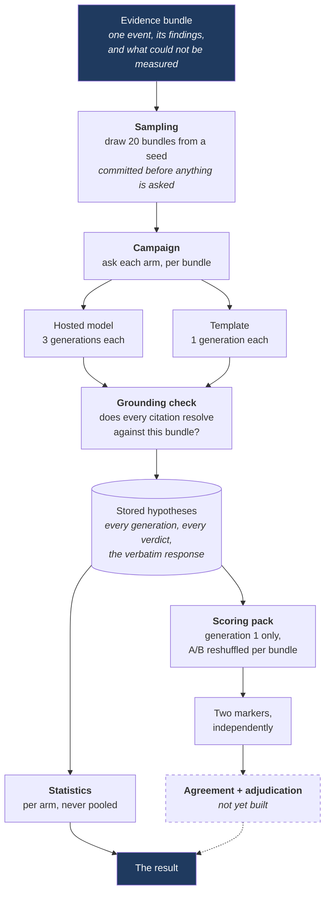
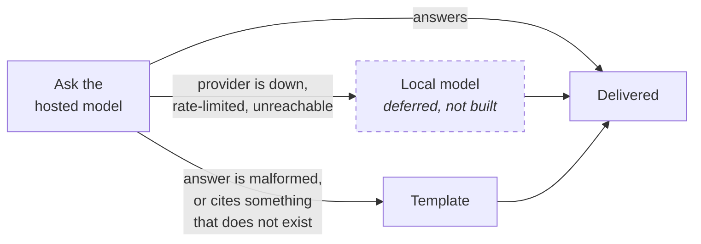
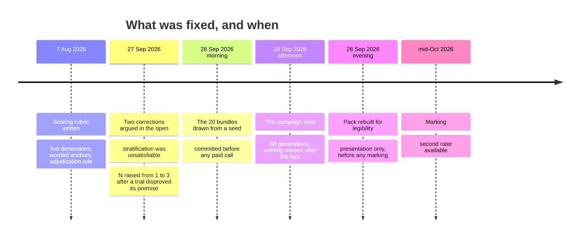

# The evaluation harness, on one page

*A standing orientation page for Phase 11, the counterpart to `docs/detection_layer.md`. **Edited,
never appended to** — if a figure here goes stale, change it in place. Last true as of 28 September
2026, after the scored campaign ran and the scoring pack was rebuilt.*

---

## The whole thing in one sentence

> **The detection layer decides what happened. The AI layer writes an explanation of it. The
> evaluation harness is how we find out whether that explanation is any good — and it has to answer
> that without taking the explainer's word for anything.**

Everything below is in service of one comparison: an explanation written by a hosted language model,
against an explanation written by a deterministic template, **over the identical evidence**, judged
by people who are not told which is which.

## Why it is hard, in three sentences

An explanation can be fluent and wrong. It can cite a rule that never ran, or cite a rule that ran
and misdescribe what it found. And the person best placed to notice is also the person whose time we
are trying to save — so if checking the explanation costs as much as doing the work, the system has
achieved nothing.

That splits the measurement in two, and **the split is the design**:

| | What it asks | Who answers | What it cannot see |
|---|---|---|---|
| **Automated grounding check** | Does every citation point at something that exists? | Code, on every generation | Whether the sentence attached to a real citation is *true* |
| **Blind human scoring** | Is the explanation actually useful? | Two people, not told which arm wrote what | Anything it does not have time to read |

The first is cheap, exhaustive and shallow. The second is expensive, tiny and deep. Neither is
sufficient and the project claims neither is.

## The pipeline

The dashed box is the only unbuilt part, and it is waiting on people rather than on code — see
**What is not built** below.

## The three arms, and the two fallbacks

There are three possible explanation writers and **two entirely separate reasons** one might be
swapped for another. Keeping those two reasons apart is one of the load-bearing design decisions in
the whole project, because merging them would make the results uninterpretable.

| Fallback | Trigger | What it means |
|---|---|---|
| **Availability** | The provider did not answer | Nothing is wrong with the answer, because there is no answer |
| **Correctness** | The answer came back unusable | Something *is* wrong with the answer, and that is a finding |

Retrying a **correctness** failure on a different model would be answering a different question.
Retrying an **availability** failure is just trying again. One exception type for both would make the
code unable to tell them apart, and the write-up unable to report them separately.

The **template arm is not scaffolding.** It is permanent, and it does two jobs at once:

1. It is what the analyst receives when a model answer fails the grounding check.
2. It is the **evaluation baseline** — the honest mechanical account of the same bundle, which is the
   only thing that turns "the model wrote something plausible" into a measurable claim.

It also acts as the **oracle for the grounding check itself.** A template hypothesis is built
entirely out of the bundle, so it is grounded *by construction* — it cannot cite something that is
not there. So if the grounding check ever flags a template hypothesis, the defect is in the check,
not in the baseline. That is why the check is validated against the template rather than the model.

## What is built, and what is not

| | What it does | State |
|---|---|---|
| **Sampling** | Draws the 20 scored bundles from one seed, records the population it drew from | **Built.** Drawn and committed before the first paid call |
| **Campaign** | Runs every arm over every sampled bundle, records everything | **Built.** Has run |
| **Grounding check** | Resolves every citation against its bundle | **Built.** 80 of 80 passed |
| **Statistics** | Per-arm catch rate, retry rate, fallback rate, cost, agreement across repeats | **Built.** Not yet reported end to end |
| **Scoring pack** | What a marker reads, blinded, plus the workbook they score in | **Built and rebuilt** |
| **Score ingest + agreement** | Two sheets in, weighted κ out, adjudication applied | **Not built — deliberately deferred.** The second marker is unavailable until mid-October, so there are no sheets to ingest. Building the ingest against invented sheets is how you discover at ingest time that you guessed the shape |
| **Detection metrics** | Precision, recall, F1 over the staged corpus | **Not built.** Owed, and independent of everything above |

## The order things happened in, and why the order is the result

A pre-registered comparison is worth nothing if the instrument could have been chosen after seeing
the answers. So the sequence matters as much as the content, and it is recorded rather than asserted:

Two of those entries are **changes to a pre-registered plan**, and both are recorded with their
reasoning in the rubric's change log rather than made quietly:

- The sample was specified as five bundles per scenario type. **That is unsatisfiable on the built
  system** — five scenario types produce only two kinds of bundle, because one detection rule was
  closed as unbuildable and two scenario types are silent by design. The stratification moved to
  bundle kind: 10 interference, 10 fault.
- The model was to be asked **once** per bundle, because temperature zero with a fixed seed should
  return the identical answer every time. The first real requests measured otherwise: 4 of 5
  comparable repeated pairs differed, one changing which *kinds* of evidence it cited. A single
  generation is therefore one draw from a distribution, not "the model's answer". N went to 3 — but
  **the human scoring stayed at one generation per arm**, because 280 values is the number on the
  ethics consent form and raising it is a re-consent, not a configuration change.

That last point is worth stating plainly: **the binding constraint on the study's size was a consent
form, not a budget.**

## What the campaign actually produced

One run, 28 September 2026, over the 20 sampled bundles.

| | Hosted model | Template |
|---|---|---|
| Generations | 60 (3 per bundle) | 20 (1 per bundle) |
| Bundles covered | 20 | 20 |
| Skipped | **0** | **0** |
| Grounding checked | 60 | 20 |
| **Grounding failures** | **0** | **0** |
| Fallbacks | 0 | — |
| Refusals | 0 | — |
| Wall time | 334.2 s | 0.008 s |
| Cost | **$0.85** | $0 |

20 of 20 complete scored pairs. 60 paid calls against a ceiling of 200; 326,106 prompt tokens and
25,269 completion tokens. Total project spend to date is about **$1.75 of a $5 budget**.

**How to read the zero.** A grounding catch rate of 0.0 on the hosted arm is a genuine result and a
narrow one. It says every rule identifier the model cited exists in the bundle it was given. It says
**nothing** about whether the sentence attached to each citation is true — the check resolves
identifiers, not prose. A real finding with a false sentence attached passes. So the catch rate is a
**lower bound on ungroundedness**, and *misdescribed reference* is left entirely to the human
scoring. This is the single most important caveat in the harness and it is the reason the human pass
exists at all.

The template's 0.0 is read differently again: it is the **oracle** reporting that the check found no
defect in itself.

## The scoring pack, and what must not be inferable

Twenty evidence packs, two explanations under each, labelled A and B. Four separate mechanisms keep
the marker from working out which arm wrote what:

1. **One renderer for both arms.** No code path anywhere branches on which arm produced a
   hypothesis. A formatting difference would be a *perfect* classifier, where prose style is only a
   hint.
2. **The labels are reshuffled per pack**, from a seed unrelated to the sampling seed. Working out
   one pack tells the marker nothing about the next.
3. **The arm key is a separate file** and is joined only after both markers' sheets are in.
4. **An automated scan** over everything the marker receives — the prose *and* the workbook's cells,
   headings, sheet names, notes and document properties — looking for the arm vocabulary.

The pack also opens with a **glossary** — every rule name, conclusion label and domain word a
marker will meet, on the page and again as a tab in the workbook they score in. Its one rule is that
a definition says what a term *denotes* and never what it *implies*: *"one aircraft's position
reports stopping"* is a definition, *"…which can indicate interference"* is the answer to the question
being asked. That is the summarising-pack failure in its most dangerous form, because prose reasoning
does not look like a computation, so it is guarded by a named list of causal connectives no
definition may contain. A citation key with no entry is refused rather than omitted — a guard which,
the first time it ran, found that the bundle test fixtures had been using a finding type the
detection layer never emits.

The blinding is **honestly imperfect and the imperfection is stated**: the template's prose is
stylistically distinctive and a marker may well recognise it. That residual threat is recorded in the
Evaluation chapter rather than claimed away. What the four mechanisms prevent is *adding* a
structural leak to a stylistic one.

### The pack was rebuilt because it was unreadable

The first pack was technically correct and practically unusable, which is a failure mode worth
recording because every automated check on it passed.

| Fault | Why it mattered |
|---|---|
| Emitted as **space-aligned plain text in a Markdown file** | Any renderer reflowed nineteen findings into one paragraph and collapsed the alignment the layout relied on. Legible only in a raw editor |
| Findings **did not name their source** | The hypotheses above them cite `RF-06:4` by name. *Evidence use* is the first of five dimensions, and it was being scored against a pack the citation could not be checked against |
| Repetition printed verbatim | Nine identical track-gap lines; the same uncertainty three times |
| The bundle's own conclusion sat tenth of nineteen | The claim under scrutiny was buried in its own supporting material |

The restructure groups findings by the rule that produced them, **lists every finding individually
inside its group**, names every source, and de-duplicates uncertainties with a count.

**The constraint that governs the fix:** grouping must never replace detail with a summary. A pack
that pre-digested its own findings would do part of the work dimension 1 is scoring — which would
shrink the measured gap between the arms, in the direction that flatters the weaker one. So nothing
was removed; only the re-reading was. In fact the restructure *exposed* two facts the old pack hid:
the RF deviations split evenly 4/4 across the two sensors, and one aircraft dropped out **twice**
inside a single window.

## Two things that went wrong in production

Both cost real money or real data, and neither was visible from a green test suite.

**The application database was two migrations behind.** The test fixtures migrate the *test*
database; nothing migrated the application one. The campaign opened, made one paid call, and died
writing the row. **A green suite says nothing about the schema the system actually runs against.**
The fix was a pre-flight check that refuses to start if the schema is not at head — placed *before*
the first billed call, because a check that runs after the money is spent is a log line.

**Rate limiting silently shrank the corpus.** The provider returned 429s and the campaign recorded
them as "provider unavailable", losing 5 generations, 2 of them scored — 18 of 20 complete pairs
instead of 20. But a 429 is not "unavailable"; it says *try again in 5.09 seconds*. Treating a
retryable condition as permanent quietly reduced a pre-registered corpus. The fix was **pacing, not
retrying** — an 11-second gap between calls — because retrying inside the campaign would have blurred
the availability fallback into the correctness one, which is the distinction the whole design rests
on.

## What this harness cannot tell you

Stated in advance, which is the only time it counts.

- **The grounding check verifies existence, not accuracy.** A true citation with a false sentence
  attached passes.
- **Two markers is two markers.** Agreement between two people is not agreement in general, and 20
  bundles is a small corpus, chosen because 280 scored values is what one person can do carefully.
- **The blinding is imperfect** on prose style, as above.
- **Only two kinds of bundle exist**, so the comparison covers interference and sensor-fault
  explanations and nothing else. A third rule would need a fresh sample.
- **Cost and latency are one run on one day.** The wall-time gap between the arms — 334 seconds
  against 8 milliseconds — is real and large, but it is a single measurement under one set of network
  conditions.
- **No result from the human pass exists yet.** Nothing in the write-up may speak as if it does.

## Vocabulary

| Term | In one line |
|---|---|
| **Arm** | One explanation writer. Hosted model, local model (not built), or template |
| **Bundle** | Everything about one detected event, and the only thing an arm is ever shown |
| **Generation** | One request, one answer. Three per bundle on the model arm |
| **Grounding** | Does each cited rule identifier exist in this bundle? Resolved on the `(rule, finding type)` pair, never the rule alone |
| **Catch rate** | Of the generations checked on one arm, the fraction the check flagged. `None`, never 0.0, when nothing was checked |
| **Retry rate** | Refusals over **attempts**, not over generations — over generations it is an average wearing the word *rate* and can exceed 1.0 |
| **Fallback** | An arm was asked and a different one answered. The stored row records both |
| **Oracle** | The template. Grounded by construction, so anything flagged on it is a defect in the check |
| **Scored generation** | Generation 1, fixed in advance, **never substituted** — swapping in a later one would delete every failure from the scored corpus |
| **Pass one / pass two** | Five quality dimensions scored blind; then, after the answers are revealed, two more judgements. Kept apart because knowing the answer changes how good an explanation feels |

## Where to look next

| Question | Document |
|---|---|
| How is the explanation scored, exactly? | `docs/scoring_rubric.md` — pre-registered, with its change log |
| What must this do? | `docs/requirements.md` |
| What is the binding definition of a capability? | `docs/spec.jsonl` |
| Why was this decided, and what lost? | `docs/thesis_notes.md` |
| What does this term mean, and what did I get wrong about it? | `docs/qa.md` |
| Why is the AI layer shaped this way at all? | `docs/phase9_hypothesis_layer.md` (written before any model code) |
| What feeds this? | `docs/detection_layer.md`, then `docs/phase8_evidence_bundles.md` |
| How do I explain this to someone outside the project? | the published progress note |
| Where does the work stand right now? | `docs/handoff.md` |
